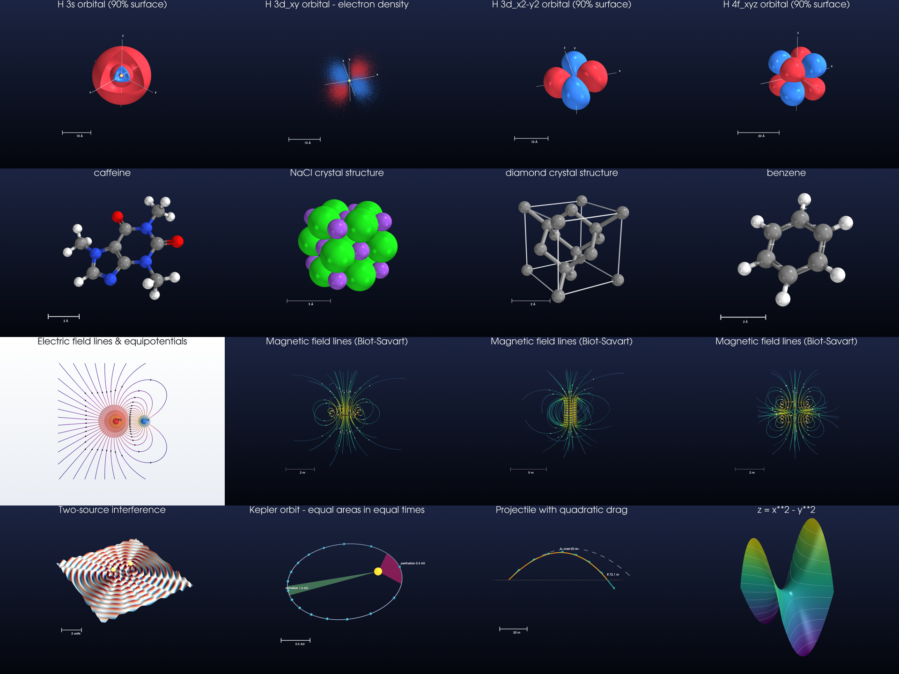

# sci3d-diagrams

A Claude skill for **realistic, scientifically accurate 3D physics and chemistry diagrams**, written in pure Python (PyVista + ASE + RDKit).

All geometry is computed rather than drawn by hand. The skill uses Coulomb's law and exact Biot–Savart for fields, Kepler's equation for orbits, RK4 integration for projectiles, exact hydrogen wavefunctions for orbitals, MMFF-optimised molecular geometry and experimental lattice constants.



## Install in Claude Code

**Option A: plugin (recommended, easy to update)**

```bash
claude plugin marketplace add <your-github-user>/sci3d-diagrams
claude plugin install sci3d-diagrams@sci3d
```

Or run the same commands inside a session as `/plugin marketplace add …` and `/plugin install …`.

**Option B: plain skill (copy the folder)**

```bash
git clone https://github.com/<your-github-user>/sci3d-diagrams.git
mkdir -p ~/.claude/skills
cp -r sci3d-diagrams/plugins/sci3d-diagrams/skills/sci3d-diagrams ~/.claude/skills/
```

The first time the skill runs, it installs its Python dependencies:

```bash
pip install pyvista ase rdkit scipy matplotlib
```

## Use

Ask Claude for a diagram in plain language, for example "draw the 3d_z2 orbital", "render caffeine in 3D", "NaCl unit cell" or "magnetic field of a solenoid". You can also run the script directly:

```bash
python scripts/sci3d.py orbital 3d_z2 -o orbital.png
python scripts/sci3d.py molecule caffeine --html          # + interactive page
python scripts/sci3d.py crystal NaCl --style spacefill
python scripts/sci3d.py efield +1@-1,0,0 -1@1,0,0 --planar --view xy
python scripts/sci3d.py bfield solenoid --gltf            # + .glb 3D model
python scripts/sci3d.py list                              # built-in molecules / crystals / orbitals
```

See [SKILL.md](plugins/sci3d-diagrams/skills/sci3d-diagrams/SKILL.md) for every command and option.

## License

MIT
